<!-- ===================== HERO ===================== -->
<div align="center">

<a href="https://mj-hesari.ir"></a>

<a href="https://mj-hesari.ir">
  
</a>

<br/>

<a href="https://mj-hesari.ir"></a>
<a href="https://www.linkedin.com/in/mj-hesari"></a>
<a href="mailto:hesarimj@gmail.com"></a>
<a href="https://t.me/Mjhe3ari"></a>
<a href="https://instagram.com/hesari.dev"></a>

<br/>


</div>

<br/>

<!-- ===================== ABOUT ===================== -->

<table>
<tr>
<td width="62%" valign="top">

**Full Stack Developer with 4+ years of experience** using React, Next.js, and TypeScript.

Skilled in building scalable, maintainable web applications, improving performance, and creating practical, user-friendly interfaces. Experienced in leading front-end development, planning features, and working with product teams.

Focused on **clean code, consistent architecture, and efficient workflows.**

```tsx
// mj-hesari.tsx
export default function Portfolio() {
  return (
    <Profile
      name="MJ Hesari"
      role="Full Stack Developer"
      stack={["React", "Next.js", "TS", "Docker"]}
    />
  );
}
```

</td>
<td width="38%" align="center" valign="middle">


</td>
</tr>
</table>


<br/>

<!-- ===================== SKILLS ===================== -->

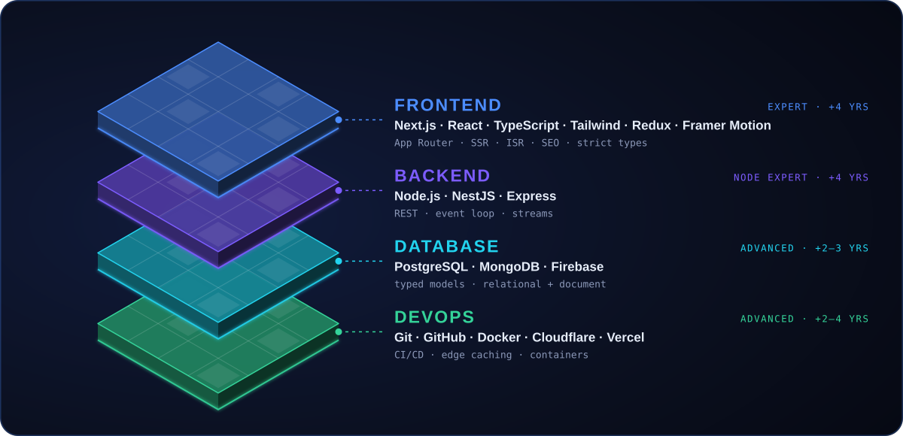

<div align="center">


</div>

<details>
<summary><b>Full breakdown — technology · level · experience</b></summary>
<br/>

| Layer | Technology | Level | Experience |
|---|---|---|---|
| **Frontend** | Next.js (App Router · SSR · SEO · ISR) |  | +4 yrs |
| | React (Hooks · Performance · Reusable Components) |  | +4 yrs |
| | TypeScript (Strict Mode · Generics · Type Safety) |  | +4 yrs |
| | Tailwind · Redux (UI state only) · Framer Motion |  | +2–3 yrs |
| **Backend** | Node.js (REST · Event Loop · Streams) |  | +4 yrs |
| | NestJS · Express |  | +2–3 yrs |
| **Database** | PostgreSQL · MongoDB · Firebase |  | +2–3 yrs |
| **DevOps** | Git (Expert) · GitHub · Docker · Cloudflare · Vercel |  | +2–4 yrs |

</details>

<br/>

<!-- ===================== EXPERIENCE ===================== -->

| Period | Role | Highlights |
|---|---|---|
| **2026 – Present** | **Freelance** · Front-end Developer | Project-based collaborations across website builders, business platforms and custom web products. Scalable, modular architectures tailored to each engagement. |
| **Aug 2024 – 2026** | **Pazh** · Front-end Developer (Full-time) | Led and mentored the front-end team on a modern website-builder platform. Designed a scalable modular architecture, enforced clean-code reviews, planned features with product & design. Shipped professional SEO: Google Schema, sitemap, robots.txt. `React` `Next.js` `Redux Toolkit` `Tailwind` |
| **Aug 2024 – Jul 2025** | **Exir** · Front-end Developer (Full-time) | Front-end for business directories, exchange directories and token-based apps on Next.js + TypeScript. Modular structures across several ongoing projects. |
| **Aug 2021 – Jan 2024** | **i3center** · Front-end Developer (Part-time) | Digital marketing & web agency. Catalog, e-commerce and landing-page projects — design/marketing requirements into responsive UIs. `HTML5` `CSS` `JavaScript` |

<br/>

<!-- ===================== WORK ===================== -->

<table>
<tr>
<td width="50%" valign="top">

### 01 · Beresta
**Coffee Marketplace** · `FULL STACK` `SEO FOCUSED`

Modern marketplace for discovering and purchasing premium coffee brands. Modular architecture with SSR, SEO optimization and reusable components; flexible content management and multilingual support.

`Next.js` `React` `TypeScript` `Tailwind` `Redux` `Docker`

⚡ SSR · Optimized images · Core Web Vitals · SEO infrastructure

📖 [Read the article](https://mj-hesari.ir/articles/beresta-coffee-marketplace)

</td>
<td width="50%" valign="top">

### 02 · Fastolearn
**Learning Platform** · `PWA` `SCALABLE ARCHITECTURE`

Course platform that turns long-form lessons into an offline-first, app-like experience. Progressive loading, service-worker background caching and an installable PWA shell around the player.

`Next.js` `TypeScript` `PWA` `Tailwind` `PostgreSQL`

⚡ Offline-first caching · Lazy-loaded video pipeline · Sub-second route transitions

</td>
</tr>
<tr>
<td width="50%" valign="top">

### 03 · IranArabic
**Directory Platform** · `MULTILINGUAL` `SCALABLE`

Bilingual business directory: two languages, two reading directions, one codebase. Locale-aware layout engine and typed content model so every listing renders correctly in RTL and LTR.

`Next.js` `TypeScript` `i18n` `Tailwind` `Docker`

⚡ Shared RTL/LTR components · Locale-based static generation · Edge caching

</td>
<td width="50%" valign="top">

### 04 · Portfolio
**Personal Site** · `FULL STACK` `PWA`

[mj-hesari.ir](https://mj-hesari.ir) — sticky project cards that stack like a deck, each with its own accent.

`Next.js` `TypeScript` `Tailwind` `Framer Motion`

⚡ Optimized images · Core Web Vitals · PWA · SEO infrastructure

</td>
</tr>
<tr>
<td colspan="2" valign="top">

### 05 · [Google Flow](https://github.com/mjhesari/mj-hesari-google-flow)
**Chrome Extension** · `BROWSER EXTENSION` `AI WORKFLOW`

A Manifest V3 panel that restores client-side access to Google Flow and Google Stitch, plus documented AI video workflows (Gemini + Veo) for story structure, prompting and generation.

`Chrome Extension` `Manifest V3` `JavaScript` `Google Flow` `Google Stitch`

📖 [Read the article](https://mj-hesari.ir/articles/google-flow)

</td>
</tr>
</table>

<br/>

<!-- ===================== ARTICLES ===================== -->

- **Sep 29, 2026** — [MJ Hesari Google Flow: access for Flow and Stitch, then cinematic AI workflows](https://mj-hesari.ir/articles/google-flow)
- **Sep 1, 2026** — [Beresta, introduced: a coffee marketplace and what it can do](https://mj-hesari.ir/articles/beresta-coffee-marketplace)

👉 [All articles](https://mj-hesari.ir/articles)

<br/>

<!-- ===================== PROCESS ===================== -->


<br/>

<!-- ===================== STATS ===================== -->

<div align="center">

<!-- generated by .github/workflows/profile-3d.yml -->
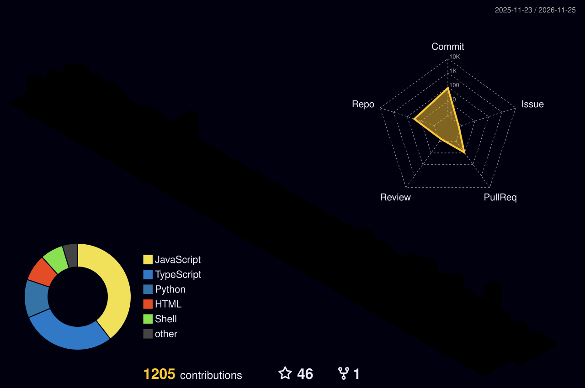


<br/>


</div>

<br/>

<!-- ===================== CONTACT ===================== -->

<div align="center">

**Have an idea? Let's turn it into reality.**<br/>
Available for freelance projects, remote opportunities, and long-term collaborations. · 🕒 GMT +3:30 · flexible hours

<a href="mailto:hesarimj@gmail.com"></a>
<a href="https://mj-hesari.ir/cv/MJ-Hesari-Resume.pdf"></a>
<a href="https://calendar.app.google/aGqLmkz8ZvVY2Zdf6"></a>

<sub><i>Code is more than syntax. It's about building systems that scale.</i></sub>

</div>


